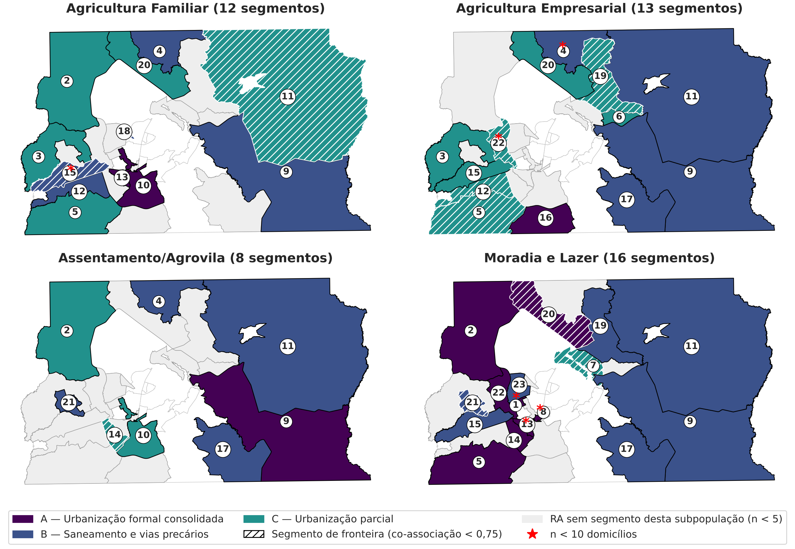

# Tipologia dos territórios rurais do DF — PDAD Rural 2022

[](https://doi.org/10.5281/zenodo.24373560)
[](https://caiorj2004.github.io/pdad_tipologia_cluster/)


Trabalho de Conclusão de Curso em Ciência de Dados e Inteligência Artificial (IESB, 2026), desenvolvido no grupo de pesquisa **Agrotec DF**, financiado pela FAPDF.
Autor: Caio Rosendo Jácome · Supervisão do TCC: Profª Simone de Araújo Góes Assis · Orientação no curso: Prof. Sérgio da Costa Côrtes.

**🌐 Resultados interativos: https://caiorj2004.github.io/pdad_tipologia_cluster/**

## Em resumo

**Pergunta.** As médias do rural do Distrito Federal escondem realidades muito diferentes: assentamentos, chácaras de lazer e agricultura empresarial convivem na mesma Região Administrativa (RA). É possível construir uma tipologia desses territórios a partir dos dados oficiais, e ela segue as divisões administrativas ou as atravessa?

**Dados.** Microdados da PDAD Rural 2022 (IPEDF): 5.075 domicílios, com pesos amostrais, agregados em **49 segmentos territoriais** (RA × subpopulação: agricultura familiar, agricultura empresarial, assentamento/agrovila, moradia e lazer) em 23 RAs, descritos por **30 indicadores em 4 dimensões** inspiradas no *Sustainable Livelihoods Framework* (bens duráveis e renda; capital humano e trabalho; capital físico, habitação e território; conectividade).

**Método.** PCA por dimensão + K-Means, com a partição posta à prova:
nulos que preservam a covariância, bootstrap de domicílios que refaz o pipeline inteiro (ARI), comparação com Ward e outros algoritmos, testes de estresse e ablação da matriz,
estatística espacial (Moran, LISA, join count) e modelos mistos (MixedLM, logit misto) para medir quanto a divisão administrativa explica.

**Resultados.**
* Três perfis: **A — urbanização formal consolidada** (12 segmentos), **B — saneamento e vias precários** (20) e **C — urbanização parcial** (17).
* A tipologia **atravessa as RAs**: 11 das 23 RAs abrigam mais de um grupo, e 68–97% da variação dos indicadores de água, esgoto e pavimentação está *dentro* dos segmentos.
* O grupo B concentra mais vulnerabilidade social (inscrição no CadÚnico de 32% contra 20%; insegurança alimentar moderada ou grave de 11,6% contra 8–9%; variáveis fora do modelo), e 75% dos domicílios de agricultura familiar estão no grupo C.
* **Leitura honesta:** nenhuma solução supera o nulo de covariância e a estabilidade no bootstrap de domicílios (ARI médio 0,54) não é maior que a de dados sem grupos. Os grupos são lidos como recortes de um **gradiente** e como hipóteses para política pública, não como tipos naturais.



**O que o repositório demonstra:** pipeline reprodutível com um comando (`python reproduzir_tudo.py`), sementes fixas e variantes declaradas em um arquivo; tratamento de microdados oficiais com pesos amostrais; validação de clustering além da silhueta; e transparência sobre o que os dados sustentam e o que não sustentam.

**Stack:** Python · pandas · NumPy · scikit-learn · SciPy · statsmodels · GeoPandas · PySAL (libpysal, esda) · Matplotlib.

---

## Detalhes técnicos (reprodutibilidade e avaliação)

Repositório de apoio ao TCC *Tipologia dos Territórios Rurais do Distrito Federal: Uma Análise de Clustering Socioespacial com a PDAD Rural 2022* (IESB, Ciência de Dados e IA).
Ele contém o código, os dados e as saídas necessárias para reproduzir **cada modelo** discutido no TCC e para **testá-los sob estresse com a mesma bateria**, conforme a avaliação crítica de 12/11/2026.

> **Modelo principal e sensibilidades.** No texto do TCC, o modelo principal é o `M2_semEscadas_K3` (IVS-DF e escala da RA fora da matriz, renda como média do ln com winsorização, geladeira e secadora fora, água e esgoto como em M0), escolha do autor. O `M0_antigo` e o `M1_revisado` são mantidos como comparação e o `M2b_aguaILR` como terceira sensibilidade. **O M2 foi definido depois de ver os resultados das variantes** (`L_sem_agua`), e nenhuma variante supera o nulo de covariância: a tipologia é um recorte descritivo de um gradiente. O repositório existe para reproduzir cada modelo e submetê-los à mesma bateria, e para mostrar quais conclusões se sustentam em todos.

## Estrutura

```
dados/gold/            microdados corrigidos (saída do programa 01) + IVS-DF (IPEDF)
dados/                 versão anterior das planilhas (sem as correções dos códigos 66666 etc.) e shapefile das RAs
dados/silver/          planilha-dicionário do IPEDF (entrada do programa 01)
legado/                scripts originais dos modelos 4D e 5D (Colab); mantidos para consulta
pipeline/              programas numerados e executores (veja abaixo)
resultados/<variante>/ saídas de cada variante (texto e CSV; figuras só de M1_revisado_K3 e M2_semEscadas_K3)
resultados/comparacao_variantes.{csv,md}   métricas de todas as variantes lado a lado
docs/                  rastreabilidade da avaliação, denominadores e notas
```

## Como reproduzir

```bash
python -m venv venv && source venv/bin/activate
pip install -r requirements.txt          # versões originais do projeto (Colab, 2025)
# Testado em Python 3.13 com: pandas 3.0, numpy 2.5, scikit-learn 1.9, scipy 1.18, statsmodels 0.15, geopandas 1.2 (ver requirements-testado.txt)

python reproduzir_tudo.py --modo teste          # verificação rápida da instalação (~5 min)
python reproduzir_tudo.py --modo principal      # modelos centrais + figuras do TCC
python reproduzir_tudo.py --modo completo       # todas as variantes (algumas horas)
python reproduzir_tudo.py --saneamento          # refaz também o programa 01 a partir de dados/silver/ e compara com dados/gold/

# ou, pelos executores em shell:
bash pipeline/rodar_variante.sh M1_revisado_K3   # uma variante (cerca de 8 min)
bash pipeline/rodar_todas.sh 2                   # todas as variantes de pipeline/variantes.tsv, 2 em paralelo
python pipeline/22_comparar_variantes.py         # consolida em resultados/comparacao_variantes.md
```

Todas as sementes são fixas (`SEED = 42`; réplicas do bootstrap usam a semente da réplica). Os resultados do K-Means dependem do número de inicializações; o executor registra os parâmetros em `config.txt`.

### Variantes (`pipeline/variantes.tsv`)

| Grupo | Variantes | O que muda |
|---|---|---|
| Modelo avaliado | `M0_antigo_K5`, `M0_antigo_K3` | matriz original: 34 variáveis, IVS-DF e escala da RA dentro, água em 3 proporções, geladeira e secadora dentro, renda = ln da média |
| Modelo principal do texto | `M2_semEscadas_K3` (e `_K4`, `_K5`) | M1 sem as escadas de água e esgoto (flags `ctx,renda,dur`); água e esgoto como em M0 |
| Terceira sensibilidade | `M2b_aguaILR_K3` (e `_K4`, `_K5` listadas, não rodadas) | M2 com a água em duas razões log-isométricas das três fontes originais (`AGUA_RAWILR=1`), sem escada |
| Modelo revisado | `M1_revisado_K3`, `M1_revisado_K5` | as 5 mudanças da avaliação juntas (flags `ctx,agua,esgoto,renda,dur`) |
| Uma mudança por vez | `A_so_ctx`, `A_so_agua`, `A_so_esgoto`, `A_so_renda`, `A_so_dur` | M0 + uma só mudança |
| Tira uma mudança | `L_sem_ctx`, `L_sem_agua`, `L_sem_esgoto`, `L_sem_renda`, `L_sem_dur` | M1 − uma mudança |
| Sensibilidade | `S_winsor95`, `S_winsor100`, `S_clr` | winsorização em P95 ou ausente; clr (3 colunas) no lugar de ilr |
| Mais réplicas | `*_b500n50` | bootstrap com 500 réplicas e 50 inicializações |

Flags do modelo (`V2`): `ctx` (IVS-DF e escala da RA saem da matriz), `agua` e `esgoto` (escada de serviço rede / individual adequado / precário, em ilr), `renda` (média de ln(1+renda) com winsorização), `dur` (geladeira e secadora saem; D1 vira "bens duráveis").

## Programas (`pipeline/`)

| Programa | Função |
|---|---|
| `01_saneamento_pdadr_2022.py` | saneamento da planilha-dicionário do IPEDF → `dados/gold/*.xlsx`. Lê `dados/silver/Dicionario_aplicado_PDADR_2022.xlsx` (incluída no repositório; rode com `python reproduzir_tudo.py --saneamento`). As saídas já estão em `dados/gold/`; detalhes em `docs/reproducao_saneamento.md`. |
| `02_analise_exploratoria_ponderada.py` | análise exploratória ponderada |
| `03_analise_cluster_4d.py` | **modelo**: agregação por segmento, PCA por dimensão, K-Means, nulos, co-associação, Moran/LISA. Parâmetros por variáveis de ambiente (`V2`, `K_FINAL`, `WINSOR_P`, `COMP`) |
| `04`–`13` | comparação de métodos, Ward, estabilidade cruzada, variáveis de apoio, Kruskal-Wallis, tabelas, mapas, robustez em tandem, perfis por RA |
| `16_robustez_amostral_e_pesos.py` | bootstrap de domicílios (fluxo inteiro refeito), ICs dos perfis, estabilidade contra nulo de covariância, encolhimento, "não classificável", K-Means ponderado |
| `17_ablacao_matriz.py` | ablação das mudanças da matriz |
| `18_variancia_ami_espacial.py` | decomposição de variância RA × subpopulação, AMI, join count |
| `19_validacao_externa.py` | EBIA, CadÚnico, benefícios, escritura, outorga |
| `20_figuras_perfil_validacao.py` | figuras de perfis e validação |
| `21_stress_estrutural.py` | testes de estresse S1–S10 (sementes, tamanho × extremidade, Wilson, aparado, arquétipos, deixa-um-fora, algoritmos, corte de n, puxão da RA, eixos) |
| `24_nulos_bootstrap_metades_territorial.py` | nulo do ARI do bootstrap, replicabilidade por metades de domicílios e nulo de atribuição domiciliar dentro do estrato (AMI de RA/subpopulação) |
| `25_multinivel_moran_ajustado_validacao_ordenada.py` | MixedLM (subpopulação fixa, RA aleatória), Moran I ajustado por composição e validação externa ordenada |
| `26_decomposicao_domiciliar_mista.py` | decomposição no nível do domicílio como a avaliação especifica: logit misto (binários) e MixedLM (renda), efeito fixo de subpopulação + RA + RA×subpopulação aleatórios |
| `22_comparar_variantes.py` | consolidação das variantes |
| `29_validacao_condicional_RA_e_eta2.py` | validação externa com permutação dentro da RA e eta² da RA nos escores |
| `28_validacao_externa_incerteza_particao.py` | validação externa refeita com os rótulos de cada réplica do bootstrap (`validacao_externa_incerteza_28*.csv`) |
| `27_tabelas_rodadas.py` | tabelas T1–T8 de `docs/tabelas_rodadas.md` e ARI entre partições (`resultados/ari_entre_particoes.csv`) |

## Dados

* `dados/gold/pdadr_domicilios.xlsx` e `pdadr_moradores.xlsx`: microdados da PDAD Rural 2022 (IPEDF) com as correções de códigos administrativos (66666, 77777, 88888, 99999 e variantes) documentadas no programa 01. São as planilhas usadas nos resultados do TCC.
* `dados/pdadr_*.xlsx` (raiz): **versão anterior**, sem essas correções; mantida só porque os scripts de `legado/` as leem.
* `dados/silver/Dicionario_aplicado_PDADR_2022.xlsx`: planilha-dicionário do IPEDF (domicílios 5.075 × 140 e moradores 15.357 × 150), entrada do programa 01.
* `dados/gold/Base_dados-IVS.xlsx`: IVS-DF (IPEDF); usado **apenas para descrição** no modelo revisado.
* `dados/regioes_administrativas.zip`: limites das RAs.

Fonte dos dados: IPEDF, PDAD Rural 2022 (https://www.ipe.df.gov.br/).

## Limitações conhecidas

* O programa 01, executado isoladamente, procura a planilha no caminho do Colab; fora do `reproduzir_tudo.py`, informe o caminho com `PDADR_SILVER=dados/silver/Dicionario_aplicado_PDADR_2022.xlsx`.
* A mediana ponderada de renda por segmento não foi implementada (a avaliação aceita a média de ln com winsorização).
* O K-Means aparado e a análise de arquétipos são implementações próprias, não os pacotes `tclust` e `archetypes` do R.
* Na validação deixa-uma-RA-fora, o PCA é mantido fixo (só o K-Means é refeito).
* Os resultados dependem da versão das bibliotecas; as diferenças esperadas são pequenas (ordem de rótulos), mas não foram medidas.


Auditoria contra a avaliação: `docs/auditoria_pipeline_vs_avaliacao.md`. A coluna opcional `extras` de `pipeline/variantes.tsv` aceita `BOOT_NIVEL=estrato;BOOT_RETENCAO=regra`, `AGUA_ESCADA=...`, `ESGOTO_ESCADA=...`.

## Licença e como citar

* O código e a documentação estão sob a licença MIT (arquivo `LICENSE`).
* Os microdados da PDAD Rural 2022 e o IVS-DF são do IPEDF; as planilhas em `dados/` são cópias tratadas e **continuam sendo dados do IPEDF (o IPEDF permite o uso para fins acadêmicos e científicos, com citação da fonte: https://www.ipe.df.gov.br/perguntas-sobre-dados-e-pesquisas-do-ipedf-codeplan, pergunta 4)**.
* Para citar, use o `CITATION.cff` (o GitHub oferece o botão "Cite this repository") ou o DOI do arquivamento no Zenodo: [10.5281/zenodo.24373560](https://doi.org/10.5281/zenodo.24373560) (DOI do conceito, que remete sempre à versão mais recente; a versão 1.0.0 é a [10.5281/zenodo.24373561](https://doi.org/10.5281/zenodo.24373561)).
